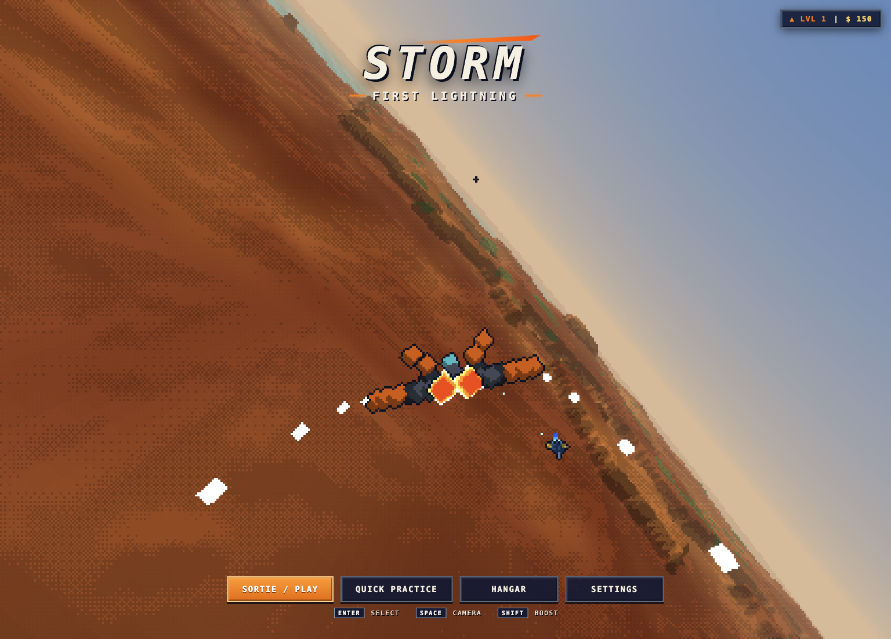
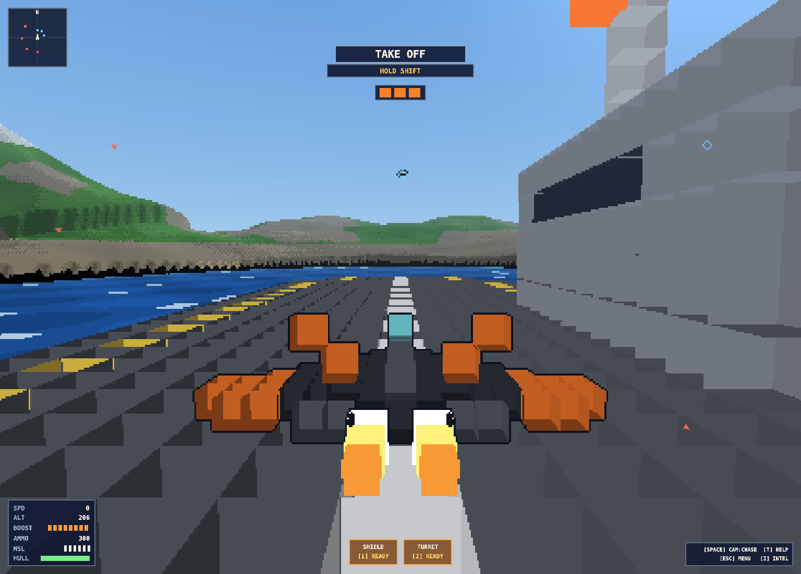
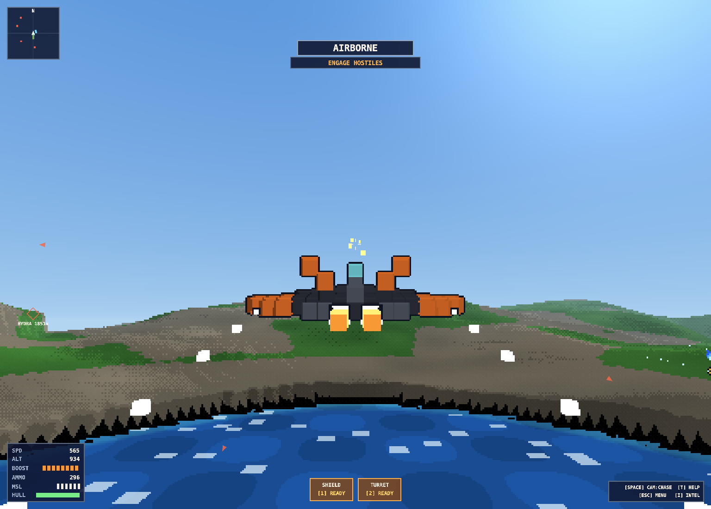
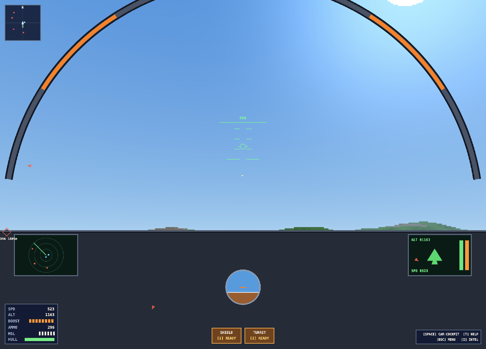
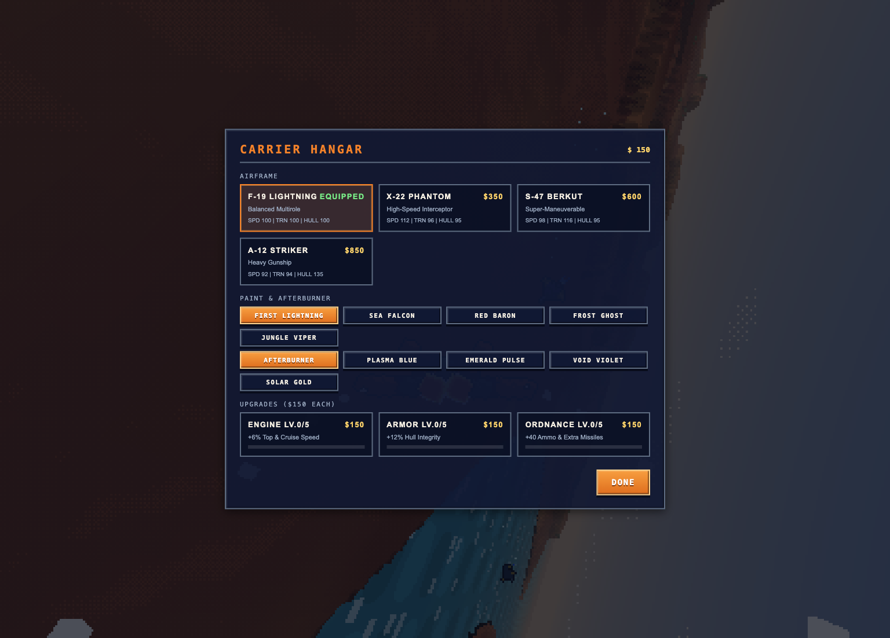

# STORM: First Lightning (TypeScript + WebGL2 Remake)

브라우저에서 즐기는 레트로 픽셀아트 3D 복셀 제트기 공중전 게임입니다.  
`https://storm.game`의 렌더링 파이프라인, 비행 물리, 전투 시스템을 분석해 순수 **TypeScript + Vite + WebGL2 + Canvas 2D + Web Audio API**로 재구현했습니다.



## Screenshots

| 항공모함 이륙 (Carrier Takeoff) | 3인칭 공중전 (Chase View) |
| :---: | :---: |
|  |  |

| 1인칭 콕핏 뷰 (Cockpit View) | 격납고 커스터마이징 (Hangar) |
| :---: | :---: |
|  |  |

## 주요 기능

- **WebGL2 저해상도 픽셀아트 3D 렌더러**
  - 토로이달 하이트필드 레이마칭 지형, 반짝이는 픽셀 해양, Bayer 4×4 디더링 구름 및 날씨(비·번개) 효과
  - 깊이 버퍼 연동 3D 인스턴스드 복셀 모델(전투기, 항공모함, 보스, 애프터버너, 콘트레일, 폭발)
  - 기체 실루엣을 또렷하게 살리는 1px 다크 픽셀 외곽선 후처리 패스
- **비행 물리 & 3종 카메라**
  - 항공모함 캐터펄트 이륙(`HOLD SHIFT`), 추력·부스트·에어브레이크·실속(Stall) 물리
  - `Space` 키로 **Chase(추적) / Cockpit(콕핏) / Overhead(탑다운)** 카메라 즉시 전환
  - 콕핏 뷰 전용 피치 래더, 실시간 레이더 스코프, 인공 수평의(자세계), 기체 상태 MFD
- **전투 시스템 & 게임 모드**
  - **8v8 Dogfight**: 아군·적군 AI 편대 공중전
  - **Leviathan Raid**: 거대 비행 전함의 엔진·포탑·원자로 코어를 부위별로 파괴하는 보스전
  - **Free Practice**: 항모 이륙 및 자유 비행/교전 연습
  - 발칸포(자동 조준 보정), 락온 유도 미사일, 플레어 회피 롤, 전술 스킬(`[1] SHIELD`, `[2] TURRET`)
- **6개 절차적 월드 & 격납고 성장**
  - `Home Waters`, `Red Canyon`, `Storm Front`, `Iron Strait`, `Frost Fjords`, `Black Rock`
  - 4종 기체(`F-19 Lightning`, `X-22 Phantom`, `S-47 Berkut`, `A-12 Striker`), 5종 도색, 5종 애프터버너, 엔진·장갑·무장 업그레이드(`localStorage` 저장)
- **Web Audio 절차적 사운드**
  - 속도·부스트에 연동되는 제트 엔진음, 발칸포, 미사일 발사, 락온 비프, 경보음, 폭발음 실시간 합성

## 조작법

| 키 / 입력 | 동작 |
| :--- | :--- |
| `W / S` 또는 `↑ / ↓` | 피치 (기수 내림 / 올림) |
| `A / D` 또는 `← / →` | 롤 (좌 / 우 선회) |
| `Q / E` | 러더 (요 회전) |
| `Shift` | 애프터버너 부스트 / 항공모함 이륙 |
| `X` | 에어브레이크 (급선회) |
| `C` 또는 `좌클릭` | 발칸포 사격 |
| `M`, `R` 또는 `우클릭` | 락온 유도 미사일 발사 |
| `F` | 플레어 투하 & 회피 롤 |
| `Space` | 카메라 시점 전환 (Chase / Cockpit / Overhead) |
| `1` / `2` | 실드 / 자동 포탑 스킬 발동 |
| `T` / `I` / `ESC` | 조작법 보기 / 전황표 / 일시정지 메뉴 |

## 실행 방법

```bash
# 의존성 설치
npm install

# 개발 서버 실행 (0.0.0.0:5173 바인딩 — 외부 네트워크 접속 가능)
npm run dev

# 타입 체크 & 프로덕션 빌드
npm run typecheck
npm run build

# 프로덕션 빌드 미리보기 (0.0.0.0:5173)
npm run preview
```

## 프로젝트 구조

```text
src/
├── main.ts       # 메인 루프, 입력 처리, 카메라 제어, 저장/불러오기
├── renderer.ts   # WebGL2 3-Pass 레이마칭 + 인스턴스드 복셀 + 픽셀 외곽선 렌더러
├── flight.ts     # 6-DOF 비행 물리, 무기, AI 편대, Leviathan 보스 시뮬레이션
├── worlds.ts     # 6개 절차적 토로이달 월드 하이트맵·색상맵 생성기
├── models.ts     # 복셀 전투기, 항공모함, 보스, 도색/애프터버너 팔레트
├── cockpit.ts    # 1인칭 콕핏 캐노피, HUD, 레이더, 자세계, MFD 오버레이
├── hud.ts        # 미니맵, 3D 타겟 락온, 텔레메트리, 스킬, 킬피드 HUD
├── ui.ts         # 스플래시, 메인 메뉴, 미션 선택, 격납고, 설정, 결과 UI
├── audio.ts      # Web Audio API 절차적 효과음 및 엔진음 합성기
├── math.ts       # 3D 벡터/기저 회전, 토로이달 좌표, 타일링 FBM 노이즈
├── tune.ts       # 비행·전투 밸런스 튜닝 상수
├── types.ts      # TypeScript 인터페이스 및 도메인 타입
└── style.css     # 레트로 픽셀 베벨 UI 스타일
```
